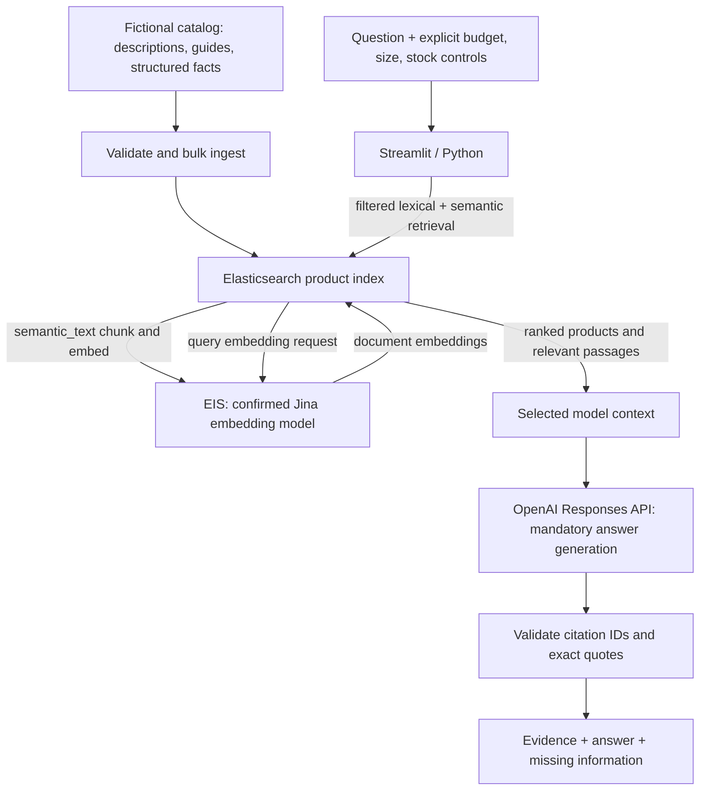

# Architecture

| Supplied heading | Attachment |
|---|---|
| Preparing the data | image (6).png / Image #3 |
| Finding the answer to the question | image (7).png / Image #2 |
| What happens inside Elastic | image (8).png / Image #1 |

## Preparing the data

`scripts.generate_catalog` creates deterministic data; `src.catalog` validates it. 
`products-index.json` is the blueprint for the Elasticsearch product index. It tells Elasticsearch how to store each field and which kinds of searches it supports. It contains configuration—not product records.

`scripts.create_index` uses explicit strict mappings and the configured inference ID.
`scripts.ingest` sends raw text and facts; Elasticsearch handles semantic chunking and
embedding requests through EIS. The same field endpoint is used for query embeddings.
There is no application-operated model server, manual vector store, or second chunk index.

Short descriptions and long guides share `searchable_content`. Prices use scaled floats
with cent precision; currency is a keyword. Nested variants preserve size/stock relationships.
The count API reports parent products, avoiding misleading internal chunk counts.

## Finding the answer

`src.search` uses match queries on semantic_text and multi_match on lexical fields.
Hybrid search uses two standard retrievers under RRF with identical structured filters.
The application checks returned eligibility as a defensive validation; retrieval itself
enforces the constraints. Failure or partial search results stop answer generation.

Semantic highlighting selects up to two relevant fragments per product. Keyword-only
results use the description as evidence. `src.context` includes facts and eligible variants,
not embeddings or the entire catalog. `src.answer` calls OpenAI on every normal submission,
including no-match cases, parses structured output, and validates citations/quotes.

The answering model is distinct from Jina. OpenAI performs no catalog embedding in this
project. The UI always shows provider failures as failures and retains successful retrieval.

## What happens inside Elastic

Vector index mode is requested explicitly to make intent reviewable. The Serverless Vector
Database project also supplies vector-oriented defaults. Inspect the actual project before
asserting its defaults. bfloat16 raw storage and BBQ quantization describe different parts
of vector storage; neither is a model-inference service.

DiskBBQ is an optional indexing choice, not a mandatory stage after BBQ. This project leaves
field index options and chunking at deployment/model defaults. Auto-calibration is not enabled.
Current Elastic documentation says it calibrates qualifying merges with at least 10,000
vectors; this catalog cannot demonstrate those benefits. See
[BBQ documentation](https://www.elastic.co/docs/reference/elasticsearch/mapping-reference/bbq).

Security comes from scoped project keys; request timings and evaluation reports give small
demo observability. Cloud monitoring and spending controls must be configured in the accounts.
The project does not claim production scalability, cost savings, or recall guarantees from
this small dataset.

## Changes from the supplied diagrams

- OpenAI is the explicit, mandatory answer-generation service.
- Filters run within both retrieval branches, before combined ranking.
- Variant inventory uses a nested size-and-stock record.
- Context assembly and citation validation are explicit application operations.
- Matching query embeddings use the field's configured Jina endpoint, not a separately
  assumed query model.
- Infrastructure boxes are configuration/capability explanations, not an execution pipeline.

